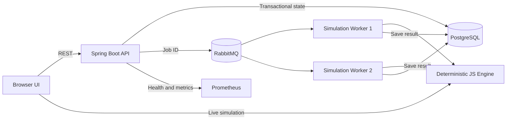
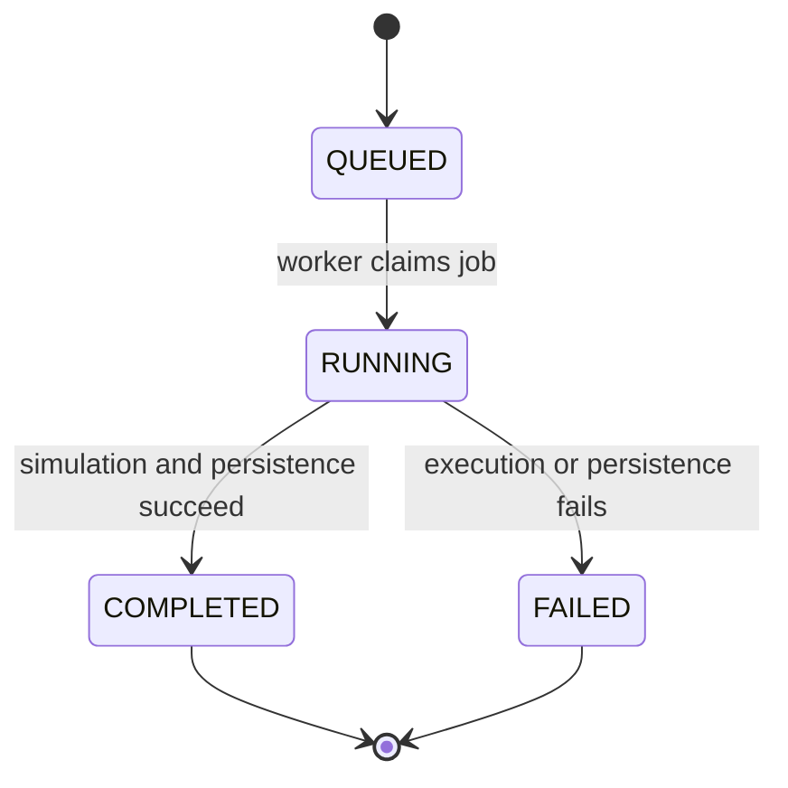

# DispatchLab Architecture

## System Context

DispatchLab separates interactive simulation from asynchronous experiment
execution. The browser remains responsible for live visualization and
deterministic local scenarios. Spring Boot provides the API boundary and
PostgreSQL persists both completed experiments and distributed job state.

## Runtime Units

### API

- validates HTTP requests;
- creates simulation jobs;
- enforces idempotency through `Idempotency-Key`;
- publishes work to RabbitMQ;
- exposes job status and experiment history.

### Simulation workers

- consume simulation job IDs;
- atomically claim one queued job;
- execute the same deterministic JavaScript engine used by the browser;
- persist the result and update the job state.
- remain horizontally scalable behind the same durable queue.

### PostgreSQL

PostgreSQL is the system of record for:

- experiments;
- job state;
- idempotency keys;
- worker ownership;
- attempt count;
- result linkage;
- failure details.

### RabbitMQ

RabbitMQ decouples request acceptance from CPU-intensive simulation execution.
The broker provides durable work delivery and a natural fan-out point for
multiple worker replicas.

## Job Lifecycle

Jobs are not rerun automatically after failure. This prevents silent duplicate
experiments while leaving an explicit retry policy to a future orchestrator.

## Consistency and Concurrency

- Job creation and initial persistence happen before RabbitMQ publication.
- Worker claims use a conditional PostgreSQL update.
- Only one worker can transition `QUEUED -> RUNNING`.
- Idempotency keys are unique in PostgreSQL.
- Repeated submissions return the original job.
- Completed experiments and the job result reference are persisted separately;
  recovery behavior is observable through explicit job status.

## Reliability Boundaries

DispatchLab intentionally keeps the first distributed version small:

- PostgreSQL remains the single source of truth.
- RabbitMQ is a durable task channel, not a second database.
- Simulation workers are stateless.
- Browser and worker executions use the same simulation engine.
- Kubernetes is a deployment phase, not a local architecture requirement.

## Observability

Spring Boot Actuator exposes health and Prometheus metrics. Simulation jobs
increment completion and failure counters. Docker Compose exposes PostgreSQL,
RabbitMQ management, API, and worker processes for local diagnosis.
